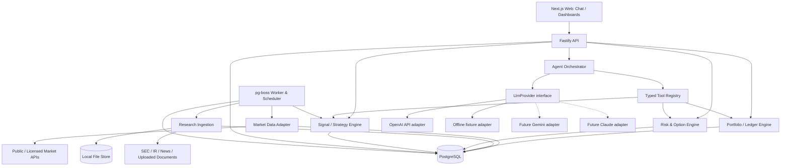

# 02 — Architecture

## 1. Style
- Standalone **TypeScript modular monolith**, split into three deployment processes: web, api, worker. One PostgreSQL DB. No microservices, Redis, Kafka or Kubernetes in MVP.
- `web`: Next.js/React/Tailwind/shadcn/ui; ECharts or Lightweight Charts for timeseries; TanStack Table optional. SSR and client UI.
- `api`: Fastify + Zod route validators, OpenAPI generation, SSE chat/event streaming; application services call pure domain engines.
- `worker`: TypeScript Node process running pg-boss schedules, refreshers, scanners, research ingestion, alert evaluation; common shared packages.
- `db`: PostgreSQL with Drizzle SQL migrations, numeric/decimal money, JSONB provenance, optional pgvector extension when semantic retrieval arrives.
- `files`: `./data/uploads` and `./data/research` mapped to Docker volume/mount; abstract `FileStore` so S3-compatible backend can replace local disk in cloud.

## 2. Logical diagram

## 3. Dependencies and boundaries
- Domain package independent of HTTP, LLM, database adapters. Pure calculations (portfolio math, option payoff, money, FX, status) use deterministic functions.
- Only repository adapters touch DB; route handlers are orchestration and validation, not financial logic.
- LLM may call only registry tools with Zod schemas; mutating tools may create **previews** only. A separate user-confirmed API commits a change. LLM cannot write SQL, run arbitrary shell commands, or query environment secrets.
- Worker jobs carry entity IDs/idempotency keys, not huge document/secret payloads. Retry safely.
- External feeds behind interfaces: `QuoteProvider`, `BarsProvider`, `OptionsProvider`, `FxProvider`, `FilingsProvider`, `NewsProvider`, `LlmProvider`, `FileStore`.
- `packages/agent` owns context, tools, run limits and financial validation; `packages/llm` owns neutral model contracts, provider selection and native adapters. Provider SDK imports are confined to adapter modules. The frontend calls M²D's API; only `api`/`worker` receive model API keys.
- All holdings originate from user input. The explicitly authorized M3 IBKR hosted MCP adapter retrieves market data only; its read-only OAuth and tool allowlist cannot synchronize accounts or submit trading instructions. See `IBKR_MCP.md` and ADR-038.

## 4. Technology decisions
- Node current supported LTS, pnpm workspaces, TypeScript strict, ESLint/Prettier, Vitest, Playwright.
- PostgreSQL; `pg-boss` for cron/durable jobs/retries/locks, to avoid a Redis dependency.
- Drizzle + explicit SQL migrations for auditability; `decimal.js` for calculations and PostgreSQL `NUMERIC` storage.
- `xlsx`/Excel parser via actively maintained, validated library selected at implementation; do not execute spreadsheet macros or formulas.
- PDF text extraction first; OCR only if necessary (not required for MVP).
- OpenAI Responses API via the official server-side SDK is the initial LLM transport, authenticated by `OPENAI_API_KEY`. No ChatGPT sign-in, OAuth, browser session, or subscription-token access. Keep the model configurable with `LLM_MODEL`; no model is selected by this design change. Avoid an external agent framework. Use strict JSON schemas for typed tool calls where supported and validate outputs again in M²D.
- Implement `OpenAIProvider` and `FixtureProvider` in v1. Reserve `GeminiProvider` and `AnthropicProvider` (Claude) for later. Capability checks, provider-scoped continuation and normalized errors are specified in `14_LLM_PROVIDERS.md`; no automatic cross-provider fallback.
- Provider APIs may be delayed or paid; no hardcoded assumption of real-time Greeks/options availability.

## 5. Configuration and time
- Single local workspace, no `tenant_id`/`user_id` on portfolio tables.
- `APP_TIMEZONE=America/Vancouver` for presentation; `MARKET_TIMEZONE=America/New_York` for U.S. market calendar. Store UTC `timestamptz` plus original source timestamps/time zones where relevant. DST and holidays accounted for.
- `BASE_CURRENCY=USD` by default but user-configurable; cash and P&L remain available in native currencies.
- All quote records include provider, quote timestamp, received_at, market session, delayed flag, and entitlement if supplied.
- `LLM_PROVIDER=openai` selects normal API-backed operation; `LLM_PROVIDER=fixture` selects explicit offline development/testing. A missing key/model makes AI unavailable with a clear configuration status, without disabling manual portfolio bookkeeping. Never silently fall back to fixture or another provider.

## 6. Cloud portability
- Use container images and environment variables; no absolute host paths in code.
- `FileStore` interface makes cloud object storage optional; PostgreSQL can be local or managed.
- If remotely deployed, keep the web interface behind private networking; defer public identity/account framework.
- Only local default web port mapped to `127.0.0.1`, DB private to compose network.

## M4 implementation boundary

See [M4 research](M4_RESEARCH.md) and ADR-041. Explicit research imports run as bounded API background tasks with durable statuses; PDF extraction uses an isolated child process. Originals are stored transactionally in PostgreSQL, rather than the planned file store. The existing independent worker remains operational; scheduled research monitoring and the worker-based research pipeline are future work. No M5/M6 services are introduced.
