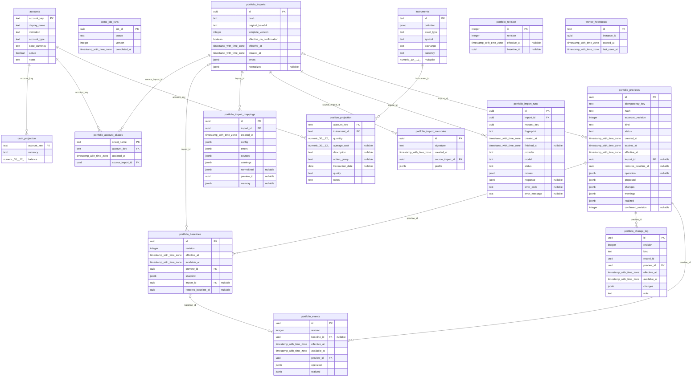

# M²D database ERD

Generated from the implemented Drizzle schema. Run `pnpm docs:erd` after schema changes; `pnpm docs:erd:check` fails when this document is stale.

This is the current M1 application schema. PostgreSQL also contains pg-boss-managed queue tables, which are maintained by pg-boss and omitted here. Historical baselines and interpretation results contain typed JSON snapshots; positions and cash below are the rebuildable current projections. Stable account IDs preserve history across display-name changes. Confirmed sheet aliases point back to the same account. Holding transaction dates are optional date-only metadata, not a reconstructed transaction ledger.

The diagram shows declared database foreign keys. Logical references without a database foreign key (including revision baseline IDs, mapping preview IDs and JSON identifiers) are deliberately not drawn. Nullable attributes are marked in quotes.

